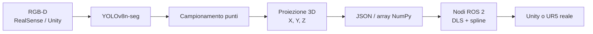

# Cloth Segmentation Pipeline
<p align="center">
  
</p>

Taglio automatico di indumenti con un braccio robotico: una rete neurale individua le parti salienti di un maglioncino (**colletto**, **polsini**, **fondomaglia**), le coordinate 3D dei punti vengono estratte da una camera RGB-D e un controllore ROS 2 muove un **UR5** lungo le traiettorie corrispondenti, sia in **simulazione Unity** sia sul **robot reale**.

Progetto del corso *Dynamics and Control of Intelligent Robots and Vehicles*.



---

## Indice
1. [Struttura del repository](#struttura-del-repository)
2. [Installazione](#installazione)
3. [Parte 1: Visione](#parte-1-visione)
4. [Parte 2: ROS 2](#parte-2-ros-2)
5. [Come collegare visione e robot](#come-collegare-visione-e-robot)
6. [Risultati](#risultati)
7. [Autori](#autori)

---

## Struttura del repository

```text
├── acquisizione.py              # Cattura RGB-D con RealSense D435i
├── data.yaml                    # Configurazione dataset YOLO
├── requirements.txt
├── yolov8n-seg.pt               # Pesi di partenza
├── codice train-test/           # Training, inferenza e verifica 3D
│   ├── yolo_train.py
│   ├── test_yolo_single.py
│   ├── yolo_inference.py        # SweaterDetector: estrazione punti 2D/3D
│   ├── verify_depth_extraction.py
│   ├── verifica_depth.py
│   ├── test_unity_inference.py
│   └── geometry_utils.py
├── ros/                         # Nodi ROS 2 (package coordinate_converter)
│   ├── setup.py
│   ├── unity/                   # home_joint_trajectory.py, spline_separata.py
│   └── ur5/                     # home_joint_final.py, spline_separata_finale.py
├── dataset_rgbd_maglioncino/    # Dataset RGB-D reale
├── risultati rete/              # Output di inferenza (immagini e JSON)
└── risultati train-val/         # Pesi e metriche del training
```

---

## Installazione

Richiede Python ≥ 3.8 (consigliato 3.10). Una GPU NVIDIA con CUDA è consigliata ma non obbligatoria.

```bash
git clone https://github.com/EttoreRii/Cloth-Segmentation-Pipeline.git
cd Cloth-Segmentation-Pipeline

python -m venv venv
source venv/bin/activate          # Windows: .\venv\Scripts\Activate.ps1

pip install --upgrade pip
pip install -r requirements.txt
```

Per usare la GPU, installa PyTorch con supporto CUDA dal [sito ufficiale](https://pytorch.org/get-started/locally/).

> Per la parte ROS 2 serve inoltre un'installazione di ROS 2 con `colcon` (vedi [Parte 2](#parte-2-ros-2)).

---

## Parte 1: Visione

Il modello è **YOLOv8n-seg** con tre classi: `0 Collar`, `1 Hem`, `2 Cuff`. Tutti gli script in `codice train-test/` risolvono i percorsi rispetto alla root, quindi si possono lanciare da qualsiasi cartella.

### 1. Acquisizione dati (opzionale)
Con la RealSense D435i collegata in USB 3.0:
```bash
python acquisizione.py
```
Applica filtri spaziale, temporale e hole-filling, fa la mediana su 15 frame e salva `<timestamp>_rgb.png` e `<timestamp>_depth.png` in `dataset_rgbd_maglioncino/`.

### 2. Addestramento (opzionale)
Il repository contiene già i pesi addestrati in `risultati train-val/yolo_run/weights/`. Per riaddestrare:

1. Annota le immagini con CVAT e converti le annotazioni nel formato YOLOv8-seg.
2. Dividi il dataset in training (80%) e validation (20%).
3. Lancia l'addestramento (30 epoche); al termine esporta anche `best.onnx`:
   ```bash
   python "codice train-test/yolo_train.py"
   ```

### 3. Test rapido su una immagine
```bash
python "codice train-test/test_yolo_single.py" --image "dataset_rgbd_maglioncino/<file>_rgb.png" --conf 0.3
```
Output: `risultati rete/inference_result.jpg`.

### 4. Estrazione dei punti 2D
```bash
python "codice train-test/yolo_inference.py"
```
Output: `yolo_inference_result.jpg` e `robot_coordinates.json` in `risultati rete/`.

### 5. Estrazione dei punti 3D (RealSense)
```bash
python "codice train-test/verify_depth_extraction.py"
```
Associa la profondità ai punti, li retroproietta in 3D, apre una point cloud Open3D (giallo: colletto, verde: polsini, magenta: fondomaglia) e stampa a console gli array NumPy pronti per il robot. Output: `robot_coordinates_3d.json` e `inference_result_depth.jpg`.

Per vedere solo la point cloud grezza: `python "codice train-test/verifica_depth.py"`.

### 6. Dati sintetici da Unity
```bash
python "codice train-test/test_unity_inference.py"
```
Legge RGB e buffer di profondità float32 (`.bin`) dal simulatore (camera zenitale, FOV verticale 60°). Output: `yolo_inference_unity_result.jpg` e `robot_coordinates_unity.json`.

### Come vengono estratti i punti
1. **Filtro IoU:** per ogni classe si tiene la maschera a confidenza maggiore.
2. **Y-averaging:** per ogni colonna `x` della maschera si calcola la media delle `y`, ottenendo la linea centrale della cucitura indipendentemente dallo spessore del tessuto.
3. **Campionamento:** `N` punti equidistanti per colletto e fondomaglia; punto iniziale e finale per ciascun polsino (separati in `sx`/`dx` lungo l'asse X).
4. **Proiezione pinhole:** `X = (x − cx)·Z / fx`, `Y = (y − cy)·Z / fy`, con `Z` in metri.

### Formato di output (`robot_coordinates_3d.json`)
```json
{
  "Cuff":   [{"start": [X, Y, Z], "end": [X, Y, Z]}, {"start": [...], "end": [...]}],
  "Hem":    [{"points": [[X, Y, Z], ...]}],
  "Collar": [{"left": [X, Y, Z], "right": [X, Y, Z], "curve_points": [[X, Y, Z], ...]}]
}
```
Coordinate in metri, nel frame della camera.

---

## Parte 2: ROS 2

Il package **`coordinate_converter`** contiene i nodi che trasformano i punti del capo in movimento del robot. Usa cinematica diretta, Jacobiano geometrico con inversione **DLS** (*Damped Least Squares*) e spline cartesiane con profili di velocità trapezoidali.

| Ambiente | Nodo | Funzione |
| :--- | :--- | :--- |
| Unity | `home_joint_trajectory` | Porta il robot in `home`/`up` in closed-loop (legge `/joint_states`, scrive su `/joint_targets`) |
| Unity | `spline_separata` | Esegue le spline sui punti del maglioncino (7 fasi di movimento) |
| UR5 reale | `home_joint_final` | Muove il robot tra `home`, `up`, `camera`, `ortogonale`, `finale` via Action `follow_joint_trajectory` |
| UR5 reale | `spline_separata_finale` | Come `spline_separata`, con gestione dell'orientamento dell'end-effector, invia i waypoint allo `scaled_joint_trajectory_controller` |

### Setup del package (obbligatorio)

Il package **deve chiamarsi `coordinate_converter`** ed essere di tipo `ament_python`. Il `setup.py` generato **va sostituito** con quello in `ros/`.

```bash
# 1. Workspace e package
mkdir -p ~/ros2_ws/src && cd ~/ros2_ws/src
ros2 pkg create --build-type ament_python coordinate_converter

# 2. Sostituisci setup.py e copia gli script (adatta il percorso del repository)
REPO=/percorso/a/Cloth-Segmentation-Pipeline
cp $REPO/ros/setup.py ~/ros2_ws/src/coordinate_converter/setup.py
cp $REPO/ros/unity/*.py $REPO/ros/ur5/*.py ~/ros2_ws/src/coordinate_converter/coordinate_converter/

# 3. Build
cd ~/ros2_ws
colcon build --packages-select coordinate_converter
source install/setup.bash
```
Puoi copiare solo gli script dell'ambiente che ti serve (`unity/` oppure `ur5/`).

### Esecuzione in simulazione Unity

Serve il bridge [ROS-TCP-Endpoint](https://github.com/Unity-Technologies/ROS-TCP-Endpoint).

```bash
# Terminale 1: bridge
ros2 run ros_tcp_endpoint default_server_endpoint --ros-args -p ROS_IP:=0.0.0.0
```
1. Premi *Play* in Unity e verifica che l'indicatore di connessione sia verde.
2. In un nuovo terminale (con `source install/setup.bash`):
```bash
ros2 run coordinate_converter home_joint_trajectory   # posizione home
ros2 run coordinate_converter spline_separata         # esegue le spline
```

### Esecuzione sull'UR5 reale

```bash
# Terminale 1: driver del robot
ros2 launch ur_robot_driver ur5.launch.py robot_ip:=<ROBOT_IP> launch_rviz:=true

# Terminale 2: posa iniziale (default: home; alternative: camera, ortogonale, up, finale)
ros2 run coordinate_converter home_joint_final
ros2 run coordinate_converter home_joint_final camera

# Esecuzione della traiettoria sul capo
ros2 run coordinate_converter spline_separata_finale
```

---

## Come collegare visione e robot

I punti calcolati dalla visione non passano ai nodi ROS automaticamente: vanno copiati nel nodo. Lo script `verify_depth_extraction.py` (o `test_unity_inference.py` per Unity) stampa a console le definizioni NumPy già pronte:

```python
polsino_sx_raw = self.rete_to_base_tf(np.array([[-0.158, 0.082, 0.725], [-0.121, 0.086, 0.724]]))
self.polsino_sx_fitto = self.prendi_punti_intermedi(polsino_sx_raw[0], polsino_sx_raw[1])
self.fondo_maglia = self.rete_to_base_tf(np.array([...]))
self.colletto = self.rete_to_base_tf(np.array([...]))
```

Incollale in `spline_separata.py` (Unity) o `spline_separata_finale.py` (UR5), ricompila con `colcon build` e lancia il nodo. `rete_to_base` converte i punti dal frame della camera al frame base del robot.

**Flusso completo:** acquisizione/Unity → `verify_depth_extraction.py` → copia degli array nel nodo → `home_*` → `spline_separata*`.

---

## Autori

Gianluca Eremita, Ettore Ricci, corso di *Dynamics and Control of Intelligent Robots and Vehicles*.